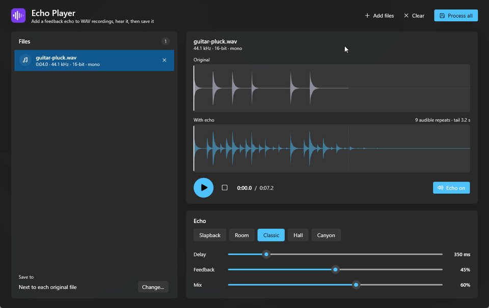
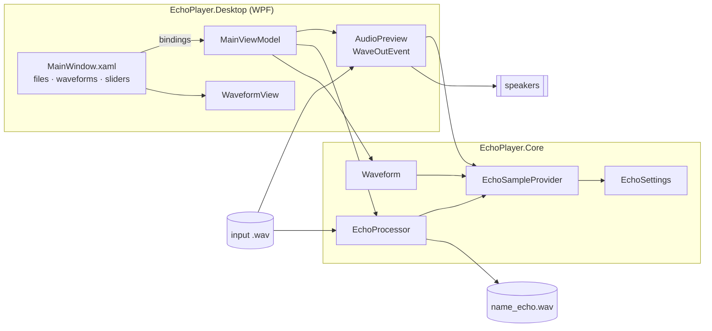
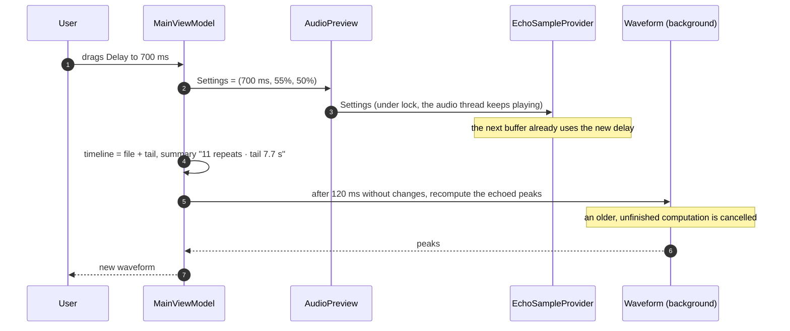

<div align="center">

# 🔊 Echo Player

[](https://github.com/pero-grubac/Echo-player/actions/workflows/ci.yml)


**Add a feedback echo to WAV recordings: hear it live while you shape it, see every repeat in the waveform, then write any number of files at once.**



</div>

---

## 📌 Project Overview

**Echo Player** is a small desktop audio tool. Load one or more `.wav` files, pick a preset or set the delay, feedback and mix yourself, and listen: the echo changes while the file plays, and the waveform shows the original next to the result, tail included. When it sounds right, **Process all** writes a copy of every file with the echo, in the same format as the original.

| Step | What you do | What you get |
|------|-------------|--------------|
| 1. Add | Drop WAV files on the window or use **Add files** | Each file with its length and format |
| 2. Shape | Choose a preset, or drag *Delay*, *Feedback* and *Mix* | The echoed waveform and the length of the tail, updated as you drag |
| 3. Listen | **Play** (or `Space`), click the waveform to jump, **Echo on/off** to compare | Live preview through the same echo that writes the files |
| 4. Save | **Process all** (`Ctrl+Enter`) | `name_echo.wav` next to each original or in a folder you choose |

---

## ✨ Features

- 🎚️ **Feedback echo** with three controls: delay (20–2000 ms), feedback (0–90%, how many repeats) and mix (level of the first repeat)
- 🎛️ **Presets**: Slapback, Room, Classic, Hall and Canyon, with the active one highlighted
- 🎧 **Live preview**: settings apply while the file plays, click anywhere on the waveform to seek, and switch the echo off to compare
- 🌊 **Waveforms** of the original and the result on one timeline, with a dashed line where the original ends and the tail begins
- 🕰️ **Full tail**: the output is longer than the input, so the last repeats are not cut off (they fade to −60 dB, at most 30 s)
- 📂 **Batch processing** in parallel, with progress for each file, a summary, and **Stop** at any time (partial files are removed)
- 🎼 **Format kept**: sample rate, channels and bit depth stay the same (16-bit, 24-bit and 32-bit float in, the same out)
- 📢 **Clipping report**: if the echo pushes samples past full scale, the file says how many, so you can lower the mix
- 🌗 **Light and dark mode** with the Windows accent colour, using the Fluent theme of WPF

### 🧮 The echo

For every channel, with a delay of `D` samples:

```
d[n] = x[n] + feedback · d[n − D]      the delay line, which feeds itself
y[n] = x[n] + mix · d[n − D]           what you hear
```

Repeat `j` of a sound has the level `mix · feedbackʲ⁻¹`. With the default settings (350 ms, 45%, 60%) that gives 9 repeats above −60 dB, so the output is 9 × 350 ms = 3.15 s longer than the input.

| Preset | Delay | Feedback | Mix | Sounds like |
|--------|------:|---------:|----:|-------------|
| Slapback | 90 ms | 10% | 55% | One quick repeat, as on old rock vocals |
| Room | 160 ms | 35% | 40% | A small, close space |
| Classic | 350 ms | 45% | 60% | The default echo |
| Hall | 420 ms | 55% | 50% | Long, rolling repeats |
| Canyon | 750 ms | 65% | 60% | Far away and slow to fade |

---

## 🛠️ Tech Stack

| Technology | Usage |
|------------|-------|
| .NET 10 / C# 14 | Runtime and language |
| WPF + Fluent theme | Desktop UI following the Windows theme and accent colour |
| CommunityToolkit.Mvvm | Observable properties, commands and cancellable async commands |
| NAudio.Core | Reading and writing WAV, sample conversion (cross-platform) |
| NAudio.WinMM | Audio output for the preview (`WaveOutEvent`) |
| xUnit | Unit tests of the echo, the tail, the file processing and the waveforms |
| GitHub Actions | Build, test and a self-contained `.exe` on every push |

---

## 📁 Repository Structure

```
Echo-player/
├── src/
│   ├── EchoPlayer.Core/                Audio processing, no UI (net10.0)
│   │   ├── EchoSettings.cs             Delay, feedback, mix, repeats and tail length
│   │   ├── EchoSampleProvider.cs       The echo as an NAudio ISampleProvider
│   │   ├── EchoProcessor.cs            File → file, progress, cancellation, output names
│   │   ├── Waveform.cs                 Peaks for drawing a file, with or without echo
│   │   └── AudioInfo.cs                Length and format of a WAV file
│   └── EchoPlayer.Desktop/             WPF app (net10.0-windows)
│       ├── ViewModels/                 MainViewModel, files, presets
│       ├── Services/                   AudioPreview (playback), dialogs
│       ├── Controls/WaveformView.cs    Waveform drawn in code, click to seek
│       ├── Themes/Styles.xaml          Cards, play button, preset chips
│       └── MainWindow.xaml
├── tests/EchoPlayer.Core.Tests/        xUnit tests
├── samples/                            Two short WAV files to try it with
├── EchoPlayer.slnx
├── Directory.Build.props               Shared build settings
├── Directory.Packages.props            Package versions in one place
└── .github/workflows/ci.yml            Build, test, publish
```

---

## 🚀 Installation

### Download

Every push to `main` builds a self-contained `EchoPlayer.exe` (no .NET installation needed). Open the latest [CI run](https://github.com/pero-grubac/Echo-player/actions/workflows/ci.yml) and download the **EchoPlayer-win-x64** artifact.

### Build from source

**Prerequisites:** Windows 10 or 11 and the [.NET 10 SDK](https://dotnet.microsoft.com/download/dotnet/10.0).

```bash
git clone https://github.com/pero-grubac/Echo-player.git
cd Echo-player
dotnet run --project src/EchoPlayer.Desktop -- samples/guitar-pluck.wav samples/drum-hits.wav
```

To build a single `.exe` yourself:

```bash
dotnet publish src/EchoPlayer.Desktop -c Release -r win-x64 --self-contained -p:PublishSingleFile=true -p:EnableCompressionInSingleFile=true -o publish
```

### Tests

```bash
dotnet test
```

---

## 🧭 Usage

1. **Add files.** Drag `.wav` files onto the window, press **Add files** (`Ctrl+O`), or pass them on the command line: `EchoPlayer.exe a.wav b.wav`. Files that are not valid WAV are skipped with a message.
2. **Pick a preset** or move the sliders. The *With echo* waveform and the *repeats · tail* line update as you drag.
3. **Listen.** Press the play button or `Space`. Click a waveform to jump there. **Echo on** switches between the result and the original while it plays.
4. **Choose where to save.** By default each result goes next to its original. **Change…** picks one folder for all of them.
5. **Process all** (`Ctrl+Enter`). Every file shows its progress, then *Saved as name_echo.wav*. An existing file is never overwritten: the next one is `name_echo (2).wav`. **Open folder** shows the results.

Supported input: PCM WAV with 8, 16, 24 or 32 bits, and 32-bit float WAV, any sample rate, any number of channels.

---

## 🏗️ Architecture

The echo lives in a plain library that knows nothing about WPF. The preview and the file writer use the **same** `EchoSampleProvider`, so what you hear is exactly what gets saved.



### What happens when a slider moves



---

## 🧭 Design Decisions

- **One echo for preview and output.** `EchoSampleProvider` is an NAudio `ISampleProvider`, so the same object plays through the sound card and writes the file. The preview cannot drift from the result.
- **Feedback instead of a single repeat.** The first version added one repeat at a fixed 50% level. A delay line that feeds itself gives natural, fading repeats, and *Feedback = 0* still gives the single repeat.
- **The tail is part of the output.** The output runs until the repeats fall below −60 dB (capped at 30 s), instead of stopping when the input stops and cutting the echo off.
- **The format is kept.** The old version always wrote 32-bit float stereo. Now 16-bit stays 16-bit, 24-bit stays 24-bit, mono stays mono.
- **Settings change while playing.** The delay line is sized for the longest delay up front, so a new delay only moves the read position, without reallocating on the audio thread.
- **Nothing blocks the window.** Files are processed in parallel on background threads with progress and cancellation, and waveforms are computed in the background with a short debounce.
- **Core without UI.** `EchoPlayer.Core` targets plain `net10.0` and only uses `NAudio.Core`, so it is tested without audio hardware and would run on Linux or macOS.
- **CI only when code changes.** Edits to the README, images, samples or license do not start a build.

---

## 📄 License

[MIT](LICENSE.txt) © 2025 Pero Grubač
